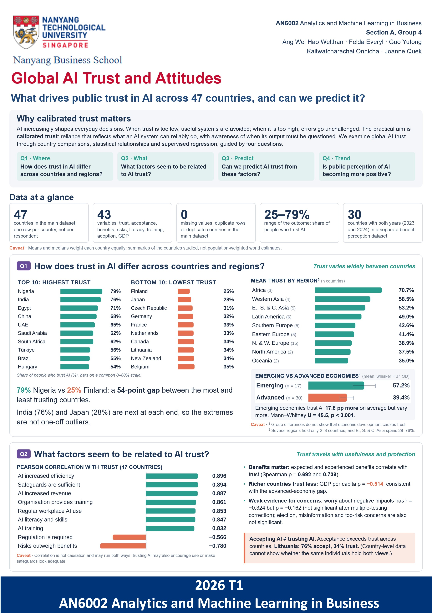
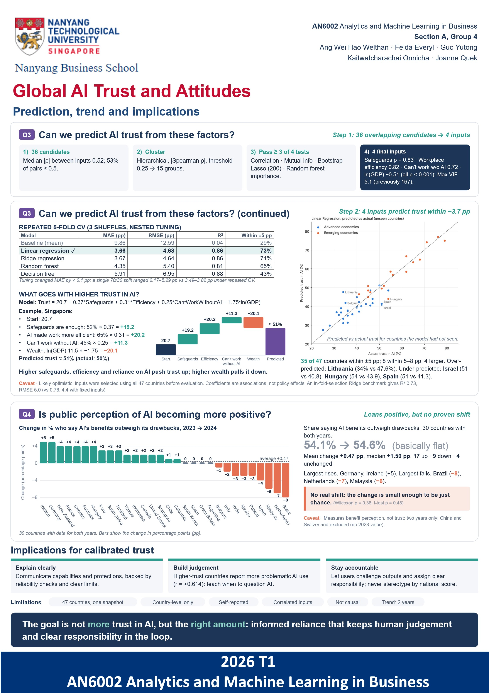

# Global AI Trust and Attitudes

  
  

This project examines how much people in 47 countries trust AI, which factors go along with that trust, and whether a country's trust level can be predicted. It was completed for AN6002 Analytics & Machine Learning in Business (Section A, Group 4, Nanyang Business School, NTU).

## Overview

The guiding idea is **calibrated trust**: reliance on AI that reflects what a system can reliably do, with awareness of when to question its output. Higher trust is not automatically better, since too little trust leads to useful systems being avoided and too much lets errors go unchallenged.

The analysis answers four research questions:

1. **Differences:** How does trust in AI differ across countries, regions and economy types?
2. **Related factors:** Which experiences and perceptions accompany higher or lower trust?
3. **Prediction:** Can those factors predict a country's trust level?
4. **Perception trend:** Is public perception of AI becoming more positive (2023 to 2024)?

**Data:** A main country-level dataset (47 countries, 43 variables, with survey percentages on trust, acceptance, benefits, risks, literacy, training and workplace outcomes) and a second dataset (32 countries, 30 with both years) on whether people think AI's benefits outweigh its drawbacks in 2023 and 2024. Each row is a country, not an individual.

**Approach:** Describe (country, economy and region comparisons), Relate (correlations with survey indicators), Predict (four regression models against an average baseline, evaluated with repeated 5-fold cross-validation), and Track (paired change in benefit perception, 2023 to 2024).

## Key Findings

- **Trust varies widely:** from 79% in Nigeria to 25% in Finland. Emerging economies report higher average trust (57.2%) than advanced economies (39.4%).
- **Acceptance is not confidence:** acceptance of AI is higher than trust across the countries studied.
- **Strongest associated factors:** perceived efficiency gains, sufficient safeguards, workplace training and AI literacy (correlations of about 0.83 to 0.90). These are associations, not causes.
- **Trust is predictable:** after narrowing 36 candidate inputs to four, linear regression predicts a country's trust to within about 3.7 percentage points on average (R² = 0.86), compared with about 9.9 for an average-only baseline.
- **Perception trend:** benefit perception rose slightly from 54.1% to 54.6%, which is not statistically significant, and countries moved in different directions.
- **Limitations:** small sample (47 countries), country-level data that can't explain individual attitudes, and probably optimistic accuracy because inputs were selected using all countries.

## Contributions

| Name | Contribution |
|------|--------------|
| Felda Everyl | Descriptive analysis |
| Guo Yutong | Feature selection analysis |
| Kaitwatcharachai Onnicha | Predictive modeling analysis |
| Joanne Quek | Reporting and consolidation |
| Ang Wei Hao Welthan | Posters & slides |
